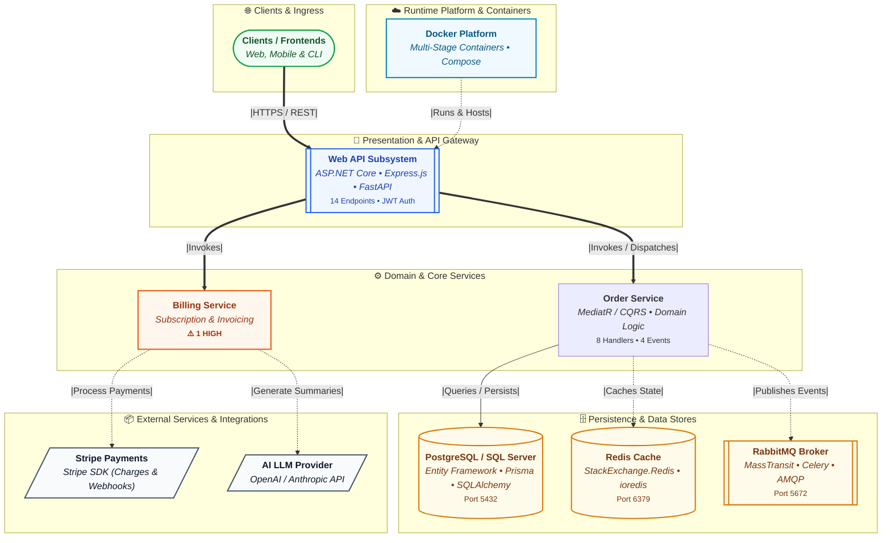
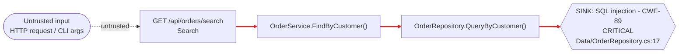

# 🏛️ Architecture Diagrams & Image Rendering Guide

`secdiagram` automatically discovers repository structure and compiles both grounded component graphs and executive-ready C4 system overview diagrams.

---

## 1. High-Level C4 System Diagrams (`secdiagram.com` style)

When explaining system design to engineers, architects, managers, or stakeholders, raw function call graphs create noise. `secdiagram` automatically compiles a clean **C4 Container / Tier System Overview Diagram** into:
- `diagram-highlevel.mmd` (Mermaid code)
- `diagram-highlevel.png` / `.svg` (Rendered image when `--image` is specified)
- Embedded at the top of `ARCHITECTURE.md`

### Visual Architecture Tiering



---

## 1a. Canonical Diagram Model & Deterministic Layout

Every diagram is a projection of a language-neutral canonical model
(`secdiagram_core.diagram_model`). Components carry a stable id, a tier
(`ingress`, `gateway`, `services`, `data`, `external`, `platform`), a kind,
and source evidence; relationships carry a kind and label. Mermaid itself
owns pixel placement, so `secdiagram` guarantees determinism by controlling
what goes in and in which order:

- Components are sorted by `(layout rank, tier, id)` and relationships by
  `(source rank, target rank, source, target, kind)`, so identical input
  always produces byte-identical `.mmd`, `.json`, and `.md` output.
- Layout ranks come from a longest-path pass over the strongly connected
  components of the dependency graph (Kosaraju in `diagram_model.py`), so
  cycles collapse into a single rank instead of producing arbitrary order.
- Ids are derived with `stable_id(...)`, never from iteration order, line
  numbers, or timestamps; adding an unrelated module leaves existing ids
  and diagram lines untouched.

### Quality Diagnostics (`--validate`)

`secdiagram --validate` runs deterministic checks against the model before
rendering and prints a stable report keyed by `DQnnn` codes:

| Code | Severity | Meaning |
| :--- | :--- | :--- |
| `DQ001` | error | Duplicate component ids |
| `DQ002` | warning | Subsystems in the same tier share a label |
| `DQ003` | warning | Diagram box with no relationships |
| `DQ004` | error | Dependency cycle |
| `DQ005` | warning | Self-referencing relationship |
| `DQ006` | error | Relationship references a missing component |
| `DQ007` | warning | Duplicated relationship |
| `DQ008` | info | Relationship points against the tier order |
| `DQ009` | warning | Many relationships skip rank levels |
| `DQ010` | info | Relationship has no kind |

The detailed renderer shares its node collapsing, path-independent ordering,
and display caps with validation. Both renderers order components and
relationships using the canonical model while retaining their grouping,
styles, source links and security overlays.

Issues are ordered by severity then code and subjects are sorted, so CI
diffs stay explainable. Validation checks the selected primary projection
and the accompanying high-level diagram in both `--dir` and `--workspace`
scans. A cycle inside one subsystem is therefore checked in `architecture`
or `full` mode; selecting `--high-level` checks the subsystem projection.
Intentionally hidden or capped nodes are not treated as dangling references.
Any error-severity code makes the command exit `1` before writing baselines,
workspace manifests or reports; existing artifacts are preserved. Incremental
index caches may still be updated during analysis. Warnings and info are
reported but do not block.
Acceptance tests in `tests/test_diagram_determinism.py` assert that repeated
runs are byte-identical and that adding one service changes only that
service's components plus a single subsystem label.

---

## 1b. Attack-Path Diagram (`diagram-taint.mmd`)

Written next to `diagram.mmd` whenever `mermaid` output is enabled. It draws each
source-to-sink taint flow as **untrusted input -> entry point -> functions on
the path -> vulnerable sink**:



Paths are ranked by severity (top 40 drawn; the rest stay in `graph.json`). The
detailed diagram highlights the same hops in red.

---

## 2. Detail Level Modes (`--diagram-detail`)

1. **`high-level` (or `--high-level`)**:
   Produces the clean, executive-ready C4 system diagram (`secdiagram.com` style) showing Subsystems, Ingress, Gateways, Core Services, Databases, Caches, Brokers, and External APIs.
2. **`architecture` (default for `diagram.mmd`)**:
   Grounded functional architecture with classes, routes, models, and external dependencies. Class methods are collapsed into parent classes and intra-feature import noise is suppressed.
3. **`full`**:
   Exhaustive raw symbol graph including individual helper functions, private methods, and modules.

```bash
# Generate high-level overview as the primary diagram:
secdiagram --dir . --high-level --image

# Generate detailed architecture flowchart:
secdiagram --dir . --diagram-detail architecture --image
```

---

## 3. Multi-Format Image Generation

Render publication-ready architecture diagrams in **PNG**, **SVG**, or **PDF**:

```bash
# Default PNG output (diagram.png and diagram-highlevel.png):
secdiagram --image

# Crisp vector SVG output:
secdiagram --image svg

# High-resolution PDF document:
secdiagram --image pdf

# Export all diagram formats simultaneously:
secdiagram --format json,md,mermaid,png,svg,pdf
```

### Rendering Providers (`--image-provider`)

1. **`auto` (explicit opt-in)**: Uses local offline Mermaid CLI (`mmdc`) if available. Otherwise, falls back to open-source Kroki or mermaid.ink HTTP endpoints via standard library `urllib` (zero pip packages required).
2. **`local` (default for `secdiagram`)**: Offline rendering via bundled Mermaid CLI (`mmdc`) + headless Chromium.
3. **`kroki`**: Uses public `https://kroki.io` or your private on-premise Kroki container (`--image-endpoint`).
4. **`mermaid.ink`**: Uses the public mermaid.ink image service.

```bash
# Enforce 100% offline rendering (errors if local mmdc is unavailable):
secdiagram --image png --offline

# Use custom on-premise Kroki gateway:
secdiagram --image png --image-provider kroki --image-endpoint http://kroki.internal:8000
```
